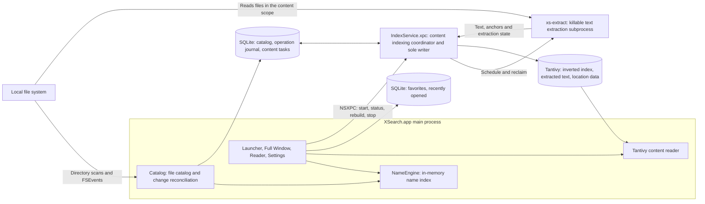

[简体中文](DESIGN.md) · **English**

# XSearch Design and Engineering Guide

This guide describes the implementation as of `v0.2.0`. It is for maintainers: how the program runs, where to change things, and how it is distributed through GitHub. The platform is macOS 26+ on Apple silicon. The interface lives in the menu bar; file name search and document text search use separate indexes and share one file catalog and change pipeline.

The product plan and its decisions (numbered D…) are in [ARCHITECTURE.md](ARCHITECTURE.md) (Chinese); `ARCHITECTURE §N` in code comments refers to its sections. The interface specification is [design/UI-SPEC.md](design/UI-SPEC.md) (Chinese). The complete query syntax for users is in the [Search Syntax and Regex Guide](SEARCH-GUIDE.en.md).

## 1. Runtime architecture



- **The main process** handles the interface, hotkey, app list, name index, directory scanning and reconciliation, plus content search and preview. Searches run in the background; a newer query cancels the old one, and the interface receives results in batches.
- **The index service** takes control requests over NSXPC, works from a task table in SQLite, and holds the content index writer. In a normal build it starts and stops with the app and its connection is warmed up at launch. Development and tests can set `XS_INPROCESS_INDEX=1` to run it in-process.
- **The extraction subprocess** wraps PDFKit, the system document readers and the Rust format parsers. On a timeout or crash the index service can terminate and reclaim it and retry according to the failure policy. Process isolation gives parser failures a recovery boundary.

## 2. Two search paths

### Name index

Directory scans use macOS file system interfaces such as `getattrlistbulk`, wrapped in C. FSEvents reports file system changes; `NameService` writes the events to the operation journal and hands them to the `Reconciler`, which checks the actual state of the directories. The catalog is stored in SQLite; the name engine serves interactive queries from a loadable snapshot plus an incremental view, merging the increments in the background. When the event history can no longer be used, the affected scope is reconciled again.

Name search supports metadata filters, wildcards and regular expressions. The name scope is broad by default; the content scope is chosen separately by the user. The shared catalog can hold files that only the content index needs, and name results still apply the name scope rules.

### Content index

The index service checks file versions, extracts the documents in scope and writes them to Tantivy. A query recalls candidates through index terms such as UTF-8 byte trigrams of the Unicode-normalized text, then matches and verifies them against the extracted text. Expressions without a usable recall term, such as very short words or pure exclusions, need a wider candidate set. This approach supports substring queries in Chinese, at the cost of broad queries reading more stored fields.

Each query uses a fixed Tantivy reader snapshot. The index stores the text with whatever anchors are available: page, paragraph, line. Hits are mapped back to the readable text and shown in the preview or the Reader. Exact mode compares against the **extracted text**. Locating a PDF page depends on the text layer and the viewer; OCR for scanned pages is reserved for later.

## 3. Consistency, recovery and data lifecycle

1. **Changes create tasks.** Catalog records hold the file ID, metadata and operation sequence number. Deleting a file, moving it out of scope or modifying it updates its content task. The file version is checked before and after extraction, and the task is checked to still be current before commit.
2. **Record in SQLite, commit in Tantivy, confirm in SQLite.** A pending batch is recorded in SQLite first, and the index commit payload carries the index instance and batch marker. On recovery these confirm batches that were committed but not yet confirmed, or clear uncommitted records and process them again.
3. **Rebuildable data and personal data are stored apart.** `catalog.sqlite`, the name snapshot and the content index can be rebuilt from the file system. A separate `user.sqlite` keeps favorites and recently opened items, and ordinary rebuilds leave it alone. Settings are managed by UserDefaults.
4. **Version changes are handled explicitly.** SQLite uses schema versions and migrations, the name snapshot checks its format and catalog identity, and the content index can switch to a new instance. A new extractor version can requeue the affected formats.
5. **Minimal access.** Text extraction starts with a few folders by default. Indexes, extracted text and temporary unpacked files stay on the Mac. Sparkle's update check is a separate network path. Storage locations, size estimates, caches and uninstalling are covered in [Files on Your Mac](STORAGE.en.md).

## 4. Source layout

The layout of the tracked sources (individual test fixtures omitted). The app bundle is not produced by an Xcode project; `scripts/build-app.sh` assembles the SwiftPM and Cargo products.

```text
XSearch/
├── App/                              # App shell: Swift + AppKit (SwiftUI for Settings and onboarding)
│   ├── Sources/
│   │   ├── main.swift, AppDelegate.swift   # Launch, data directory, menu bar, wiring the services
│   │   ├── LauncherPanel.swift             # ⌥Space launcher: input, mode switch, `in ` prefix, syntax summary
│   │   ├── SearchSession.swift             # One name search session and its result rows
│   │   ├── ContentSearcher.swift           # Content search: background, cancellable, delivered in batches
│   │   ├── ContentPane.swift, ResultViews.swift  # Result list, hit highlighting, preview pane
│   │   ├── FullWindow.swift                # Full Window (⌘E)
│   │   ├── ReaderWindow.swift              # Reader (⌘↵): step through hits
│   │   ├── ArchiveMembers.swift            # Archive members as results of their own
│   │   ├── ResultMenu.swift                # Result context menu (spec: docs/design/CONTEXT-MENU.md)
│   │   ├── Opener.swift, QuickLookKeyboard.swift  # Open With, jump to page/line, Quick Look keys
│   │   ├── Settings.swift, Preferences.swift, Onboarding.swift  # Settings UI, UserDefaults, first-launch guide
│   │   ├── IndexServiceClient.swift        # IndexService.xpc client: warm-up, status, reconnect
│   │   ├── HotKey.swift                    # Global hotkey (Carbon, no Accessibility permission)
│   │   ├── Updater.swift                   # Sparkle auto-update
│   │   └── Theme.swift                     # Colors and sizes from UI-SPEC §2
│   ├── Resources/
│   │   ├── Info.plist, XSearch.entitlements
│   │   ├── AppIcon.icon/                   # Icon Composer icon; XSearchTemplate-18*.png is the menu bar icon
│   │   ├── en.lproj/, zh-Hans.lproj/       # InfoPlist.strings, e.g. permission prompts
│   │   └── sparkle-public-key.txt          # Update signing public key, written to SUPublicEDKey at build time
│   └── IndexService/Info.plist             # Info.plist of the XPC service
│
├── Packages/                         # SwiftPM modules (targets defined in the root Package.swift)
│   ├── XSearchCore/                  # Scope rules, name keys, name and content query syntax, file kinds, localization
│   │   ├── Sources/                  #   Strings+en.swift is the English UI string table
│   │   └── CXSearchCore/             #   Header and shim calling the Rust C ABI (name keys share its folding)
│   ├── NameEngine/                   # Name snapshot, in-memory view and incremental overlay
│   │   └── CScan/                    #   Bulk scanning with getattrlistbulk, in C
│   ├── Catalog/                      # SQLite (WAL) catalog, FSEvents, reconciliation, app list, migrations,
│   │                                 #   content tasks and batch recovery (ContentIndexer), XPC control protocol
│   ├── IndexService/main.swift       # IndexService.xpc entry point
│   ├── Extraction/                   # PDFKit / AppKit / textutil extraction, archives, subprocess scheduling
│   │   └── Worker/main.swift         #   xs-extract subprocess entry point
│   └── ContentEngine/                # UniFFI-generated Swift bindings and preview window mapping
│       └── xs_ffiFFI/                #   Generated C header and modulemap (scripts/gen-bindings.sh)
│
├── rust/                             # Rust workspace (root Cargo.toml / Cargo.lock)
│   ├── xs-core/                      # Unicode normalization, offset mapping, low-level C ABI, query syntax,
│   │                                 #   plus the M0 extraction and recovery-protocol validators
│   ├── xs-index/                     # Tantivy content index: schema, writing, recall, verification, reading
│   ├── xs-parsers/                   # Plain text, Office, web, e-book and archive (incl. UnRAR) parsers
│   └── xs-ffi/                       # UniFFI exports, built as libxs_ffi.a for the app
│
├── cli/xs/                           # `xs` command-line validation tool (import corpora, search, extract, fault injection)
├── native/                           # Early platform probes: m0 (PDFKit, legacy DOC, XPC permission chain),
│                                     #   m0b (XPC round-trip latency, Vision OCR)
├── bench/m0b/                        # M0-B benchmarks (separate workspace, instrumented copy of Tantivy)
│
├── scripts/
│   ├── env.sh                        # Project-local toolchain environment (source it; global PATH untouched)
│   ├── build-app.sh, build-dmg.sh, release.sh  # Assemble and sign the .app, build the DMG, write the appcast
│   ├── source-archive.sh, collect-licenses.py  # Corresponding source archive, Rust crate license texts
│   ├── fetch-sparkle.sh, gen-bindings.sh       # Fetch the pinned Sparkle, generate UniFFI bindings
│   ├── swift-test.sh, regression.sh            # Swift tests, release regression gate
│   ├── perf_compare.py, perf-baseline.json     # Performance comparison and baseline
│   ├── bench-memory.sh                         # Memory measurement
│   └── run-m0*.sh, *.command, other *.py       # M0 / M0-B validation, probes and sample tools
│
├── Tests/Fixtures/                   # Shared fixtures: m0 (Unicode, normalization, DOCX), m4 (RAR)
│                                     #   Module tests live in Packages/*/Tests and rust/*/tests
│
├── Package.swift                     # SwiftPM targets and linker settings
├── Cargo.toml, Cargo.lock            # Rust workspace and dependency lock
├── README.md, README.en.md
├── LICENSE, LICENSES/, THIRD_PARTY_NOTICES.md
└── .gitignore                        # Ignores .tools/, target/, work/, docs/archive/ and more
```

SwiftPM target dependencies: `XSearch` (App) → `Catalog` → `NameEngine`, `Extraction` → `ContentEngine`, `XSearchCore`; at the bottom, `xs_ffiFFI` and `CXSearchCore` link the Rust static library. `IndexService` depends only on `Catalog`, and `xs-extract` only on `Extraction`. A query syntax change usually touches `Packages/XSearchCore/Sources/*Query.swift`, `rust/xs-core/src/query.rs` and the search guide ([Chinese](SEARCH-GUIDE.md) and [English](SEARCH-GUIDE.en.md)).

### Local directories (not tracked)

```text
XSearch/
├── .tools/          # Project-local Rust toolchain (rustup, cargo caches) and Sparkle; needed to build
├── target/          # Cargo and SwiftPM products, XSearch.app and DMGs; can be regenerated any time
├── work/            # Validation and benchmark output, module caches (scripts/env.sh points to work/m0/*-cache),
│                    #   release files (work/releases/) and source archives (work/source/)
└── docs/archive/    # Development records, see section 5
```

## 5. Documentation and GitHub configuration

User-facing and engineering documents come in Chinese (`*.md`) and English (`*.en.md`); each starts with a link to the other language. Specifications for maintainers (ARCHITECTURE, UI-SPEC and the notes under `docs/design/`) and the third-party notices are in Chinese only.

```text
XSearch/
├── README.md, README.en.md               # Repository home: features, install, first search, building, license
├── CHANGELOG.md, CHANGELOG.en.md         # User-facing changes per version; release notes come from here
├── CONTRIBUTING.md, CONTRIBUTING.en.md   # Environment, tests, commit conventions, release steps
├── .github/
│   ├── workflows/ci.yml                  # On pushes to main and PRs: Rust/Swift tests, clippy, ad-hoc build
│   ├── ISSUE_TEMPLATE/                   # Bug report and feature request forms
│   └── pull_request_template.md          # Verification and documentation checklist
├── LICENSE                               # GPLv3 text
├── LICENSES/
│   ├── XSearch-UnRAR-linking-exception.md    # XSearch's UnRAR linking exception
│   └── UnRAR-license.txt                     # UnRAR license text
├── THIRD_PARTY_NOTICES.md                # Third-party licenses and itemised dependency list
└── docs/
    ├── DESIGN.md, DESIGN.en.md           # This guide: architecture and engineering index of the implementation
    ├── ARCHITECTURE.md                   # Product plan and decision record (code comments cite its sections)
    ├── SEARCH-GUIDE.md, SEARCH-GUIDE.en.md   # Search syntax and regex guide for users
    ├── STORAGE.md, STORAGE.en.md         # Runtime file locations, size estimates, cleanup and uninstall
    ├── assets/
    │   └── xsearch-overview-zh.png       # Product overview image for the README
    ├── design/
    │   ├── UI-SPEC.md                    # Interface and interaction specification
    │   ├── design-tokens.json            # Design tokens
    │   ├── CONTEXT-MENU.md               # Launcher result context menu
    │   ├── LOCALIZATION.md               # How the UI is localized and how to add strings
    │   └── prototype/                    # HTML interactive prototypes (*.dc.html, canvas.json)
    └── archive/                          # Not tracked: development records
        ├── README.md                     #   Archive index
        ├── architecture/                 #   Plan snapshots ARCHITECTURE-v*.md, v0.3 review
        ├── milestones/m0 … m5/           #   Milestone plans, status, validation evidence
        ├── reviews/                      #   Code reviews, fix reviews, idle energy review
        ├── drafts/                       #   Original drafts of the curated documents
        ├── DEV-DISK-USAGE.md             #   Development disk usage measured on 2026-11-01
        └── README-dev-M0-M3.md           #   The M0–M3 README (incl. xs CLI usage)
```

The archive exists only on the maintainer's machine. Earlier versions of those files remain in the repository history and can be checked out by commit.

The repository is `github.com/davie-01/xsearch`. CI runs on GitHub's hosted `macos-26` runners and skips the performance baseline, which needs a fixed machine; the hotkey, TCC prompts, XPC and the update path still need manual checks in a normal desktop session. Each GitHub release, tagged `v<version>`, holds the DMG, `appcast.xml`, the corresponding source archive and release notes taken from the changelog.

## 6. Building, regression testing and releasing

Day-to-day builds use `bash scripts/build-app.sh`. The script fetches the pinned Sparkle, builds Rust and Swift, assembles the `.app`, and signs from the inside out: helpers, frameworks, worker, XPC service, then the app. Verify the static library, helpers and resources through the packaged app. The DMG flow is in `scripts/build-dmg.sh`. During development you can point the app at a separate data directory, or set `XS_LANG=en` to launch it in English:

```sh
XS_DATA_DIR="$PWD/work/dev-data" ./target/XSearch.app/Contents/MacOS/XSearch
```

Before a release, run `bash scripts/regression.sh` to check Rust, Swift, query correctness and performance; the baseline is `scripts/perf-baseline.json` (`--update-baseline` records the current machine). Also check, in a normal desktop session on the target macOS version: download, first launch, folder permissions, live changes, quit and relaunch, rebuilds and upgrades. Verify the app signature, the DMG's SHA-256 and the bundled notices as well.

**Release licensing.** XSearch is released under GPLv3 with an UnRAR linking exception; the current build compiles UnRAR into the Rust static library. The scripts add the release materials automatically:

- `build-app.sh` copies `LICENSE`, `LICENSES/*` and `THIRD_PARTY_NOTICES.md` to `XSearch.app/Contents/Resources/Licenses/`, and `scripts/collect-licenses.py` gathers the license texts of every Rust crate linked into `libxs_ffi.a` into `Rust-crates.txt`.
- `build-dmg.sh` adds a “许可与源码” (licenses and source) folder to the DMG: the license files above and `对应源码.txt`, which gives the download address of the corresponding source (`release.sh` points `XS_SOURCE_URL` at the source archive of the same release).
- `scripts/source-archive.sh <version>` exports the sources at tag `v<version>` and vendors every Rust dependency locked in `Cargo.lock` with `cargo vendor` (including the UnRAR source shipped in `unrar_sys`), producing `work/source/XSearch-<version>-source.tar.gz`, which builds without crates.io. It stays out of `work/releases/` so that `generate_appcast` doesn't take it for an update.

Before uploading, check that the tag, the DMG and the source archive have the same version. [GPLv3](../LICENSE) · [UnRAR linking exception](../LICENSES/XSearch-UnRAR-linking-exception.md) · [Third-party notices](../THIRD_PARTY_NOTICES.md#unrar-与-gplv3-发行)

**GitHub and Sparkle.** Run the release script in the project root. It changes the version and build number of the app and of IndexService, and writes its output to `work/releases/` (override with `XS_RELEASE_DIR`). Building and uploading to GitHub are separate steps.

```sh
XS_SIGN_IDENTITY='Apple Development: …' XS_GITHUB_REPO='davie-01/xsearch' bash scripts/release.sh 0.2.0
git commit -am "Release 0.2.0" && git tag -a v0.2.0 -m "XSearch 0.2.0"
git push origin main v0.2.0
bash scripts/source-archive.sh 0.2.0
```

Then create the `v0.2.0` release on GitHub, mark it as latest, and upload the DMG and `appcast.xml` from `work/releases/` and the source archive from `work/source/`.

The script reads the EdDSA private key from the `xsearch` account in the login Keychain and writes a signed appcast. The public key in the app (`App/Resources/sparkle-public-key.txt`) must pair with the release key; only the maintainer holds the private key. The update feed points to `appcast.xml` of the latest release by default. Before publishing, check the URL, version and signature of every archive and delta in the XML, then test the update from the previous version. Use a clean `XS_RELEASE_DIR` for each release so older packages don't pick up the current tag's download prefix. Notarization needs a Developer ID Application certificate: after saving credentials with `xcrun notarytool store-credentials <name>`, set `XS_NOTARY_PROFILE=<name>` and the matching `XS_SIGN_IDENTITY`; the scripts then sign with a secure timestamp, submit the DMG for notarization and staple the ticket. Without it, notarization is skipped. [Sparkle publishing guide](https://sparkle-project.org/documentation/publishing/)
