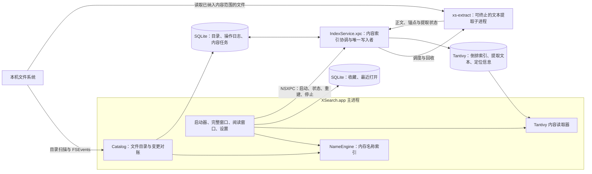

# XSearch 设计与工程指南

本文以提交 `ca30e7e` 的实现为准，供维护者了解程序如何运行、从哪里修改，以及怎样通过 GitHub 分发。平台为 macOS 26+、Apple Silicon。界面常驻菜单栏，文件名搜索和正文搜索使用各自的索引，共用文件目录与变更流水线。

产品方案与历次决策（D 编号）见 [ARCHITECTURE.md](ARCHITECTURE.md)，代码注释中的 `ARCHITECTURE §N` 指向该文件的章节；界面规范见 [design/UI-SPEC.md](design/UI-SPEC.md)；面向用户的完整查询语法见 [SEARCH-GUIDE.md](SEARCH-GUIDE.md)。

## 1. 运行架构



- **主进程**负责界面、热键、应用列表、名称索引、目录扫描与对账，以及内容检索和预览。搜索放在后台执行，查询更新时取消旧任务，界面按批次接收结果。
- **索引服务**通过 NSXPC 接收控制请求，以 SQLite 任务表承接工作，并持有内容索引的写入器。常规打包随主程序启动和停止，启动时预热连接。开发和测试可用 `XS_INPROCESS_INDEX=1` 走进程内实现。
- **提取子进程**封装 PDFKit、系统文档读取器和 Rust 格式解析器。超时或异常退出时，索引服务可以结束并回收子进程，按失败策略重试。进程隔离给解析失败提供了恢复边界。

## 2. 两条检索路径

### 名称索引

目录扫描使用 C 封装的 `getattrlistbulk` 等 macOS 文件系统接口。FSEvents 提供文件系统变化通知，`NameService` 将事件写入操作日志并交给 `Reconciler` 核对目录实际状态。目录数据存入 SQLite，名称引擎用可载入的快照和增量视图支持交互查询，后台合并增量。遇到不可继续使用的事件历史时，重新对账相关范围。

名称模式支持元数据过滤、通配符和正则。名称范围默认较广，内容范围由用户单独选择。共用目录数据库可记录只服务于内容索引的文件，展示名称结果时仍执行名称范围规则。

### 内容索引

索引服务核对文件版本并提取已纳入范围的文档，再写入 Tantivy。查询按 Unicode 归一化后的 UTF-8 字节三元组等索引条件召回候选，随后以已提取的正文执行匹配和核验。短词、纯排除等缺少可用召回条件的表达式需要扩大候选范围。这个做法支持中文子串查询，代价是宽泛查询可能读取更多存储字段。

一次查询使用固定的 Tantivy 读取快照。索引保存正文及页码、段落、行号等可用锚点。命中映射回供阅读的文本，交由预览或阅读窗口显示。严格原文模式以**提取文本**为比较对象。PDF 页定位取决于文字层和阅读器，扫描页的 OCR 仍处于预留阶段。

## 3. 一致性、恢复与数据生命周期

1. **变更产生任务**。目录记录维护文件 ID、元数据和操作序号。文件删除、移出范围及修改会更新内容任务。提取前后核对文件版本，提交前核对任务是否仍为最新。
2. **SQLite 预记，Tantivy 提交，SQLite 确认**。待确认批次先记录在 SQLite，索引提交载荷包含索引实例与批次标记。恢复时据此确认已提交但尚未确认的批次，或清理未提交记录并重新处理。
3. **可重建数据与个人数据各有存储**。`catalog.sqlite`、名称快照、内容索引可从文件系统重建。独立的 `user.sqlite` 保存收藏和最近打开记录，常规重建会保留它。应用设置由 UserDefaults 管理。
4. **版本演进显式处理**。SQLite 使用 schema 版本和迁移，名称快照校验格式和目录身份，内容索引可换用新实例。提取器版本变更可以针对受影响的格式重新排队。
5. **最小化访问范围**。默认从少量目录开始进行正文提取。索引、提取出的正文和临时解包文件留在本机。Sparkle 的更新查询是独立的网络路径。存储位置、容量估算、缓存和卸载细节见 [STORAGE.md](STORAGE.md)。

## 4. 源码目录

以下为已纳入 git 的源码布局（省略测试样例中的单个文件）。应用包不由 Xcode 工程生成，而是由 `scripts/build-app.sh` 把 SwiftPM 与 Cargo 的产物组装起来。

```text
XSearch/
├── App/                              # 应用壳：Swift + AppKit（设置与引导用 SwiftUI）
│   ├── Sources/
│   │   ├── main.swift、AppDelegate.swift   # 启动、数据目录、菜单栏与各服务装配
│   │   ├── LauncherPanel.swift             # ⌥Space 启动器：输入、模式切换、`in ` 前缀、语法速查
│   │   ├── SearchSession.swift             # 一次名称搜索的会话与结果行
│   │   ├── ContentSearcher.swift           # 内容检索：后台执行、可取消、分批投递
│   │   ├── ContentPane.swift、ResultViews.swift  # 结果列表、命中高亮与预览面板
│   │   ├── FullWindow.swift                # 完整搜索窗口（⌘E）
│   │   ├── ReaderWindow.swift              # 阅读窗口（⌘↵）：逐处跳转命中
│   │   ├── ArchiveMembers.swift            # 压缩包成员作为独立结果
│   │   ├── ResultMenu.swift                # 结果右键菜单（规范见 docs/design/CONTEXT-MENU.md）
│   │   ├── Opener.swift、QuickLookKeyboard.swift  # 打开方式、定位到页/行，快速查看按键
│   │   ├── Settings.swift、Preferences.swift、Onboarding.swift  # 设置界面、UserDefaults、首次引导
│   │   ├── IndexServiceClient.swift        # IndexService.xpc 客户端：预热、状态、重连
│   │   ├── HotKey.swift                    # 全局快捷键（Carbon，无需辅助功能权限）
│   │   ├── Updater.swift                   # Sparkle 自动更新
│   │   └── Theme.swift                     # UI-SPEC §2 的颜色与尺寸
│   ├── Resources/
│   │   ├── Info.plist、XSearch.entitlements
│   │   ├── AppIcon.icon/                   # Icon Composer 图标；XSearchTemplate-18*.png 为菜单栏图标
│   │   ├── en.lproj/、zh-Hans.lproj/       # 权限提示等 InfoPlist.strings
│   │   └── sparkle-public-key.txt          # 更新签名公钥，构建时写入 SUPublicEDKey
│   └── IndexService/Info.plist             # XPC 服务的 Info.plist
│
├── Packages/                         # SwiftPM 模块（目标定义在根目录 Package.swift）
│   ├── XSearchCore/                  # 范围规则、名称键、名称与内容查询语法、文件类别、本地化
│   │   ├── Sources/                  #   Strings+en.swift 为英文界面文字表
│   │   └── CXSearchCore/             #   调用 Rust C ABI 的头文件与 shim（名称键共用折叠规则）
│   ├── NameEngine/                   # 名称快照、内存视图与增量覆盖层
│   │   └── CScan/                    #   C 实现的 getattrlistbulk 批量扫描
│   ├── Catalog/                      # SQLite（WAL）目录、FSEvents、对账、应用清单、迁移、
│   │                                 #   内容任务与批次恢复（ContentIndexer）、XPC 控制协议
│   ├── IndexService/main.swift       # IndexService.xpc 入口
│   ├── Extraction/                   # PDFKit / AppKit / textutil 提取、归档处理、子进程调度
│   │   └── Worker/main.swift         #   xs-extract 提取子进程入口
│   └── ContentEngine/                # UniFFI 生成的 Swift 绑定与预览窗口映射
│       └── xs_ffiFFI/                #   生成的 C 头文件与 modulemap（scripts/gen-bindings.sh）
│
├── rust/                             # Rust workspace（根目录 Cargo.toml / Cargo.lock）
│   ├── xs-core/                      # Unicode 归一化、偏移映射、底层 C ABI、查询语法，
│   │                                 #   以及 M0 阶段的提取、恢复协议验证实现
│   ├── xs-index/                     # Tantivy 内容索引：schema、写入、召回、核验与读取
│   ├── xs-parsers/                   # 纯文本、Office、网页、电子书与归档（含 UnRAR）解析
│   └── xs-ffi/                       # UniFFI 导出，编译为应用链接的 libxs_ffi.a
│
├── cli/xs/                           # `xs` 命令行验证工具（导入语料、检索、提取、故障注入）
├── native/                           # 早期平台探针：m0（PDFKit、旧 DOC、XPC 权限链路）、
│                                     #   m0b（XPC 往返延迟、Vision OCR）
├── bench/m0b/                        # M0-B 基准（独立 workspace，使用插桩的 Tantivy 副本）
│
├── scripts/
│   ├── env.sh                        # 项目内工具链环境（source 后使用，不改全局 PATH）
│   ├── build-app.sh、build-dmg.sh、release.sh  # 组装与签名 .app、打 DMG、生成 appcast
│   ├── fetch-sparkle.sh、gen-bindings.sh       # 获取锁定版本 Sparkle、生成 UniFFI 绑定
│   ├── swift-test.sh、regression.sh            # Swift 测试、发版回归门禁
│   ├── perf_compare.py、perf-baseline.json     # 性能对比脚本与基线
│   ├── bench-memory.sh                         # 内存测量
│   └── run-m0*.sh、*.command、其余 *.py        # M0 / M0-B 验证、探针与样本工具
│
├── Tests/Fixtures/                   # 共享测试样例：m0（Unicode、归一化、DOCX）、m4（RAR）
│                                     #   各模块测试位于 Packages/*/Tests、rust/*/tests
│
├── Package.swift                     # SwiftPM 目标与链接配置
├── Cargo.toml、Cargo.lock            # Rust workspace 与依赖锁
├── README.md
├── LICENSE、LICENSES/、THIRD_PARTY_NOTICES.md
└── .gitignore                        # 忽略 .tools/、target/、work/、docs/archive/ 等
```

SwiftPM 目标的依赖关系：`XSearch`（App）→ `Catalog` → `NameEngine`、`Extraction` → `ContentEngine`、`XSearchCore`，两条底层分别经 `xs_ffiFFI` 与 `CXSearchCore` 链接 Rust 静态库；`IndexService` 只依赖 `Catalog`，`xs-extract` 只依赖 `Extraction`。修改查询语法时通常要同时改 `Packages/XSearchCore/Sources/*Query.swift`、`rust/xs-core/src/query.rs` 及 [SEARCH-GUIDE.md](SEARCH-GUIDE.md)。

### 本地目录（不纳入 git）

```text
XSearch/
├── .tools/          # 项目内 Rust 工具链（rustup、cargo 缓存）与 Sparkle，构建必需
├── target/          # Cargo、SwiftPM 产物，以及 XSearch.app、DMG，可随时重新生成
├── work/            # 验证与基准输出、模块缓存（scripts/env.sh 指向 work/m0/*-cache）
└── docs/archive/    # 开发过程文档归档，见第 5 节
```

## 5. 文档与 GitHub 配置

```text
XSearch/
├── README.md                         # 仓库首页：功能、安装、第一次搜索、源码构建、许可
├── CHANGELOG.md                      # 面向用户的版本变化，Release 说明取自这里
├── CONTRIBUTING.md                   # 开发环境、测试、提交约定与发布步骤
├── .github/
│   ├── workflows/ci.yml              # 推送 main 与 PR 时：Rust/Swift 测试、clippy、ad-hoc 构建
│   ├── ISSUE_TEMPLATE/               # 问题反馈、功能建议表单
│   └── pull_request_template.md      # 验证与文档同步清单
├── LICENSE                           # GPLv3 原文
├── LICENSES/
│   ├── XSearch-UnRAR-linking-exception.md   # XSearch 的 UnRAR 链接例外
│   └── UnRAR-license.txt                    # UnRAR 许可原文
├── THIRD_PARTY_NOTICES.md            # 第三方许可与逐项依赖清单
└── docs/
    ├── DESIGN.md                     # 本文：按当前实现维护的架构与工程索引
    ├── ARCHITECTURE.md               # 产品方案与决策记录（代码注释引用其章节号）
    ├── SEARCH-GUIDE.md               # 面向用户的搜索语法与正则指南
    ├── STORAGE.md                    # 运行时文件位置、容量估算、清理与卸载
    ├── assets/
    │   └── xsearch-overview-zh.png   # README 产品概览图
    ├── design/
    │   ├── UI-SPEC.md                # 界面与交互规范
    │   ├── design-tokens.json        # 设计变量
    │   ├── CONTEXT-MENU.md           # 启动器结果右键菜单规范
    │   ├── LOCALIZATION.md           # 界面多语言做法与新增文字流程
    │   └── prototype/                # HTML 交互原型（*.dc.html、canvas.json）
    └── archive/                      # 不纳入 git：开发过程文档
        ├── README.md                 #   归档索引
        ├── architecture/             #   方案历次快照 ARCHITECTURE-v*.md、v0.3 评审
        ├── milestones/m0 … m5/       #   阶段计划、状态、验证证据
        ├── reviews/                  #   代码审查、修复复核、静默能耗审查
        ├── drafts/                   #   文档整理稿原件
        ├── DEV-DISK-USAGE.md         #   2026-11-01 开发磁盘占用实测
        └── README-dev-M0-M3.md       #   M0–M3 阶段的旧 README（含 xs CLI 用法）
```

归档目录只保存在本机。仓库历史中仍保留这些文件此前的版本，如需追溯可按提交检出。

仓库地址为 `github.com/davie-01/xsearch`。CI 运行在 GitHub 的 `macos-26` 托管机上，不跑性能基线（需要固定机器），热键、TCC、XPC 与更新链路仍需在正常桌面会话中手动验证。每个 GitHub Release 按 `v<版本>` 保存 DMG、`appcast.xml`、对应源码包和取自 CHANGELOG 的发行说明。

## 6. 构建、回归与发布

日常构建用 `bash scripts/build-app.sh`。脚本获取固定版本 Sparkle、构建 Rust 与 Swift、组装 `.app`，并从内到外签名辅助程序、框架、工作进程、XPC 与主程序。静态库、辅助进程和资源都应通过打包后的应用入口验证。DMG 流程见 `scripts/build-dmg.sh`。开发时可指定单独的数据目录，或用 `XS_LANG=en` 以英文界面启动：

```sh
XS_DATA_DIR="$PWD/work/dev-data" ./target/XSearch.app/Contents/MacOS/XSearch
```

发布前用 `bash scripts/regression.sh` 核对 Rust、Swift、查询正确性和性能，基线在 `scripts/perf-baseline.json`（`--update-baseline` 以当前机器重新记录）。另在目标 macOS 版本的正常桌面会话验证下载、首次运行、目录授权、实时变更、退出再启动、重建和升级。建议同时核对应用签名、DMG SHA-256 和第三方声明附件。

**发行许可。** XSearch 以 GPLv3 加 UnRAR 链接例外发布，当前构建把 UnRAR 编入 Rust 静态库。发行材料由脚本自动带上：

- `build-app.sh` 把 `LICENSE`、`LICENSES/*`、`THIRD_PARTY_NOTICES.md` 复制到 `XSearch.app/Contents/Resources/Licenses/`，并用 `scripts/collect-licenses.py` 汇总链接进 `libxs_ffi.a` 的全部 Rust crate 许可原文为 `Rust-crates.txt`。
- `build-dmg.sh` 在 DMG 中放入“许可与源码”文件夹：上述许可文件，以及写明对应源码下载地址的 `对应源码.txt`（`release.sh` 通过 `XS_SOURCE_URL` 指向同版本 Release 中的源码包）。
- `scripts/source-archive.sh <版本>` 从 `v<版本>` tag 导出源码，并用 `cargo vendor` 收录 `Cargo.lock` 锁定的全部 Rust 依赖（含 `unrar_sys` 自带的 UnRAR 源码），生成可离线构建的 `work/source/XSearch-<版本>-source.tar.gz`。它不放进 `work/releases/`，以免 `generate_appcast` 把它当成更新包。

上传前核对发布标签、DMG 与源码包版本一致。[GPLv3 原文](../LICENSE) · [UnRAR 链接例外](../LICENSES/XSearch-UnRAR-linking-exception.md) · [第三方许可](../THIRD_PARTY_NOTICES.md#unrar-与-gplv3-发行)

**GitHub 与 Sparkle。** 发行仓库确定后，在项目根目录运行发布脚本。它会修改主应用与 IndexService 的版本及构建号，将产物输出到 `work/releases/`（可用 `XS_RELEASE_DIR` 改变）。构建动作与 GitHub 上传是两个步骤。

```sh
XS_SIGN_IDENTITY='Apple Development: …' XS_GITHUB_REPO='davie-01/xsearch' bash scripts/release.sh 0.2.0
git commit -am "Release 0.2.0" && git tag -a v0.2.0 -m "XSearch 0.2.0"
git push origin main v0.2.0
bash scripts/source-archive.sh 0.2.0
```

随后在 GitHub 新建 `v0.2.0` Release 并标为 Latest，上传 `work/releases/` 中的 DMG 与 `appcast.xml`，以及 `work/source/` 中的源码包。

该脚本从登录钥匙串的 `xsearch` 账户读取 EdDSA 私钥，生成带更新签名的 appcast。应用内的公钥（`App/Resources/sparkle-public-key.txt`）必须与发布密钥配对，私钥仅供维护者保管。更新源默认指向 Latest Release 中的 `appcast.xml`。发布前核对 XML 中每个归档和增量附件的 URL、版本和签名，再用上一版实测更新。建议每次使用一个干净的 `XS_RELEASE_DIR`，避免旧包被套用当前标签的下载前缀。公证需要 Developer ID Application 证书：用 `xcrun notarytool store-credentials <名称>` 保存凭据后，设置 `XS_NOTARY_PROFILE=<名称>` 与对应的 `XS_SIGN_IDENTITY`，脚本会以安全时间戳签名，并在打包后提交公证、装订票据。未设置时跳过公证。[Sparkle 发布文档](https://sparkle-project.org/documentation/publishing/)
